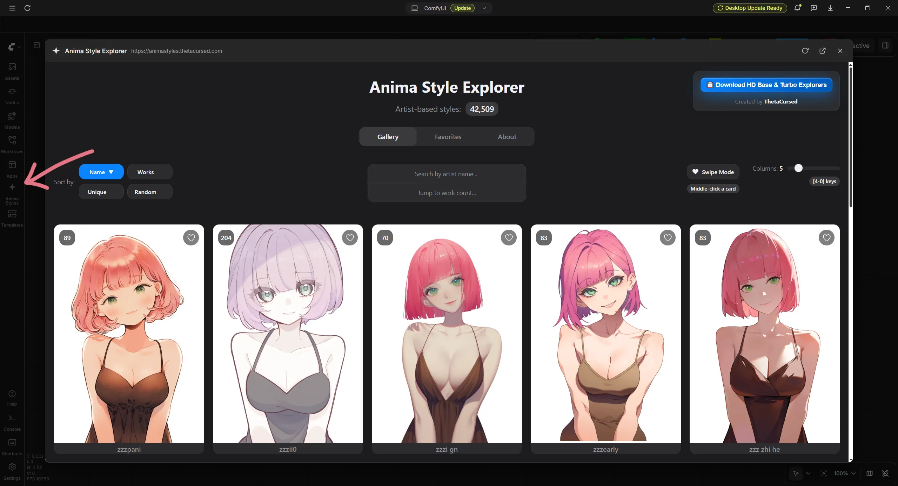

# AnimaStyleExplorer

###
The extension opens a window containing the website https://animastyles.thetacursed.com/ directly within ComfyUI. While primarily designed for the Comfy Desktop application, it can also be used with the standard version of ComfyUI.


## Installation

```bash
cd ComfyUI/custom_nodes
git clone https://github.com/Lariany-Yana/AnimaStyleExplorer.git
```
OR
```bash
comfy node install animastyleexplorer
```

### Usage
Simply click the icon in the sidebar, and a web page will open.

